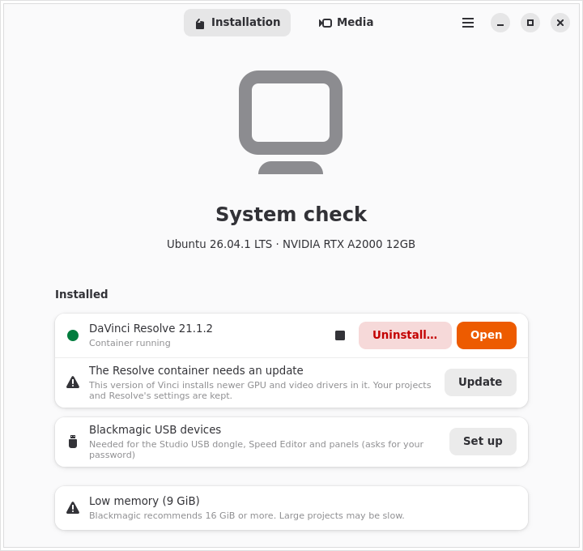

<p align="center"></p>

<h1 align="center">Vinci</h1>

<p align="center"><b>DaVinci Resolve on any Linux distribution.</b><br>
An unofficial installer that runs Resolve in an isolated container with full GPU acceleration.</p>

<p align="center">
  <a href="https://dionatansimioni.github.io/vinci/">Website</a> ·
  <a href="https://github.com/dionatansimioni/vinci/releases/latest">Download</a> ·
  <a href="README.pt-BR.md">Leia em português</a>
</p>

<p align="center"></p>

> [!IMPORTANT]
> Vinci is an independent project, **not affiliated with Blackmagic Design**. DaVinci Resolve
> is a trademark of Blackmagic Design Pty. Ltd. Vinci does not include or redistribute
> Resolve: you download the official installer from Blackmagic's website.

DaVinci Resolve is only officially supported on Rocky Linux. Vinci gives it a stable,
controlled environment: a pinned Ubuntu 24.04 container run with [distrobox](https://distrobox.it) and
podman, with direct access to your GPU. Resolve then behaves the same on Ubuntu, Fedora,
Arch, openSUSE, Mint, Pop!_OS, Bazzite and others, and your system libraries are never touched.

## Features

- **System check.** GPU, driver, RAM and disk are checked first, and Vinci explains in plain
  words what may cause trouble. Only what certainly won't work is blocked.
- **Finds the installer.** Free and Studio zips are detected in `~/Downloads`. Vinci can also
  open Blackmagic's download page and wait for the file to arrive. Versions with known
  problems are flagged.
- **Prepares the tools.** Podman is installed with your package manager after you confirm,
  and a pinned distrobox goes into your user folder.
- **GPU acceleration.**

  | GPU | How | Status |
  |---|---|---|
  | NVIDIA | your system's proprietary driver (CUDA) | ✅ tested |
  | AMD | ROCm inside the container | experimental (RDNA; RDNA1/Vega with an override) |
  | Intel | NEO compute runtime (Arc, 12th gen and newer) | experimental (Blackmagic doesn't support Intel on Linux) |

  Hybrid laptops use the dedicated GPU by default, and you can switch it in Preferences.
- **Desktop integration.** Vinci adds a menu entry with its icon and makes `.drp`/`.drt`
  files open in Resolve. Sound plays through your desktop's PipeWire.
- **Media conversion.** Resolve can't read AAC audio on Linux, and the free edition can't
  open H.264/H.265. Vinci converts such files to DNxHR HQ, ProRes 422, MPEG-4 (Diolinux
  preset), or fixes the audio only. It also turns renders into MP4 (H.264 or H.265). The GPU
  is used when available, with automatic CPU fallback.
- **Watch folders.** Files dropped into the import or export folder are converted in the
  background, with a tray icon and notifications, even while Vinci is closed.
- **Lives in the tray.** Closing the window keeps Vinci in the system tray. It asks the
  first time, and Preferences can make it quit instead.
- **Maintenance.**
  - Self-diagnosis runs on every start, with a one-click **Repair**.
  - Resolve updates are done in place, and the container's drivers are updated with them.
  - A restore point is saved before each update, with **Go back to this version**.
  - A copy of the last working installer is kept.
- **Free and Studio.** Studio can be activated with a license key or a USB dongle. Safe udev
  rules cover the dongle, Speed Editor and panels. Switching edition installs into a new
  container.
- **Clean uninstall.** Only what Vinci installed is removed. Your projects are kept unless
  you ask otherwise.
- **For advanced users.** A terminal inside the container, marked `⬢ vinci-free`, and a
  button to open the installation folder.
- **Private.** No telemetry. Local logs are optional and hide your user name, and a
  **Copy diagnostic report** button helps with bug reports.
- **English and Brazilian Portuguese.**

## Install

1. Download `Vinci-<version>-x86_64.AppImage` from the
   [latest release](https://github.com/dionatansimioni/vinci/releases/latest).
2. Make it executable: `chmod +x Vinci-*-x86_64.AppImage`, or use your file manager's
   Properties dialog.
3. Run it. Vinci adds itself to your app menu.

**Requirements:**
- x86_64 with a supported GPU.
- glibc 2.39 or newer, which means distros from 2024 on.
- 8 GiB of RAM (16 GiB recommended).
- 12 GiB of free disk space (40 GiB recommended).
- Internet access for the first install.

A Flathub release is planned.

## Build from source

You need stable Rust, GTK 4.14+ and libadwaita 1.5+ (on Ubuntu, `libgtk-4-dev libadwaita-1-dev`).

```sh
cargo test                                  # full test suite
cargo run -p vinci                          # run the app
build-aux/appimage/build.sh                 # build the AppImage (needs podman)
cargo run -p rli-core --example watchdog    # check that every external dependency still exists
```

- `crates/core`: all the logic, with no GTK, fully testable.
- `crates/app`: the interface (relm4 + libadwaita).
- `data/recipe.toml`: everything that changes over time (image, packages, repositories, URLs).
- `docs/`: design decisions (`SPEC.md`) and facts checked against primary sources (`FACTS.md`), in Portuguese.
- `site/`: the website, published to GitHub Pages.

Translations live in `po/`. A test fails if any UI text is untranslated; run
`scripts/update-po.sh` after changing strings. After changing dependencies, run
`scripts/third-party.sh`.

## License

Vinci is free software: GPL-3.0-or-later (see [LICENSE](LICENSE)). The licenses of the
libraries it uses and bundles, and where to get their source code, are listed in
[THIRD-PARTY.md](THIRD-PARTY.md).
