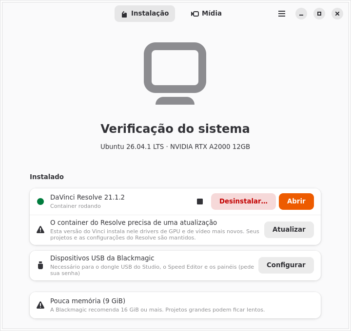

<p align="center"></p>

<h1 align="center">Vinci</h1>

<p align="center"><b>DaVinci Resolve em qualquer distribuição Linux.</b><br>
Um instalador não oficial que roda o Resolve num container isolado com aceleração total da GPU.</p>

<p align="center">
  <a href="https://dionatansimioni.github.io/vinci/pt/">Site</a> ·
  <a href="https://github.com/dionatansimioni/vinci/releases/latest">Baixar</a> ·
  <a href="README.md">Read in English</a>
</p>

<p align="center"></p>

> [!IMPORTANT]
> O Vinci é um projeto independente, **sem afiliação com a Blackmagic Design**. DaVinci
> Resolve é marca registrada da Blackmagic Design Pty. Ltd. O Vinci não inclui nem
> redistribui o Resolve: você baixa o instalador oficial no site da Blackmagic.

Oficialmente, o DaVinci Resolve só é suportado no Rocky Linux. O Vinci cria para ele um
ambiente estável e controlado: um container Ubuntu 24.04 de versão fixa, rodando com
[distrobox](https://distrobox.it) e podman, com acesso direto à sua GPU. Assim o Resolve
funciona da mesma forma no Ubuntu, Fedora, Arch, openSUSE, Mint, Pop!_OS, Bazzite e outras,
sem alterar as bibliotecas do seu sistema.

## Recursos

- **Verificação do sistema.** Antes de tudo, o Vinci confere GPU, driver, RAM e disco e
  explica em português claro o que pode dar problema. Só bloqueia o que certamente não
  funciona.
- **Encontra o instalador.** Os zips Free e Studio são detectados em `~/Downloads`. O Vinci
  também pode abrir a página de download da Blackmagic e esperar o arquivo chegar. Versões
  com problemas conhecidos são avisadas.
- **Prepara as ferramentas.** O podman é instalado pelo gerenciador de pacotes, com a sua
  confirmação, e um distrobox de versão fixa vai para a sua pasta de usuário.
- **Aceleração por GPU.**

  | GPU | Como | Situação |
  |---|---|---|
  | NVIDIA | driver proprietário do sistema (CUDA) | ✅ testado |
  | AMD | ROCm dentro do container | experimental (RDNA; RDNA1/Vega com ajuste) |
  | Intel | runtime NEO (Arc, 12ª geração e mais novas) | experimental (a Blackmagic não suporta Intel no Linux) |

  Notebooks híbridos usam a GPU dedicada por padrão, e dá para trocar nas Configurações.
- **Integração com o desktop.** O Vinci cria o atalho no menu, com ícone, e faz os arquivos
  `.drp`/`.drt` abrirem no Resolve. O som sai pelo PipeWire do seu desktop.
- **Conversão de mídia.** No Linux, o Resolve não lê áudio AAC, e a edição gratuita não abre
  H.264/H.265. O Vinci converte esses arquivos para DNxHR HQ, ProRes 422 ou MPEG-4 (preset
  Diolinux), ou corrige só o áudio. Também transforma renderizações em MP4 (H.264 ou H.265).
  Usa a GPU quando disponível, com volta automática para a CPU.
- **Pastas monitoradas.** Arquivos colocados na pasta de importação ou de exportação são
  convertidos em segundo plano, com ícone na bandeja e notificações, mesmo com o Vinci
  fechado.
- **Fica na bandeja.** Fechar a janela deixa o Vinci na bandeja do sistema. Na primeira vez
  ele pergunta, e nas Configurações dá para fazê-lo sair de vez.
- **Manutenção.**
  - Autodiagnóstico a cada abertura, com **Reparar** em um clique.
  - O Resolve é atualizado no lugar, e os drivers do container são atualizados junto.
  - Um ponto de restauração é salvo antes de cada atualização, com **Voltar a esta versão**.
  - Uma cópia do último instalador que funcionou fica guardada.
- **Free e Studio.** O Studio pode ser ativado com chave de licença ou dongle USB. Regras
  udev seguras cobrem o dongle, o Speed Editor e os painéis. Trocar de edição instala num
  container novo.
- **Desinstalação limpa.** Só é removido o que o Vinci instalou. Seus projetos ficam, a
  menos que você peça o contrário.
- **Para usuários avançados.** Um terminal dentro do container, marcado com `⬢ vinci-free`,
  e um botão para abrir a pasta da instalação.
- **Privacidade.** Nenhuma telemetria. Os logs locais são opcionais e escondem o seu nome de
  usuário, e o botão **Copiar relatório de diagnóstico** ajuda a relatar problemas.
- **Português do Brasil e inglês.**

## Instalação

1. Baixe o `Vinci-<versão>-x86_64.AppImage` na
   [última versão](https://github.com/dionatansimioni/vinci/releases/latest).
2. Torne-o executável com `chmod +x Vinci-*-x86_64.AppImage`, ou pelas Propriedades do
   gerenciador de arquivos.
3. Abra. O Vinci se adiciona ao menu de aplicativos.

**Requisitos:**
- PC x86_64 com GPU suportada.
- glibc 2.39 ou mais nova, ou seja, distros de 2024 em diante.
- 8 GiB de RAM (16 GiB recomendados).
- 12 GiB livres em disco (40 GiB recomendados).
- Internet na primeira instalação.

Uma versão no Flathub está planejada.

## Compilar a partir do código

Você precisa de Rust estável, GTK 4.14+ e libadwaita 1.5+ (no Ubuntu, `libgtk-4-dev libadwaita-1-dev`).

```sh
cargo test                                  # toda a suíte de testes
cargo run -p vinci                          # abre o app
build-aux/appimage/build.sh                 # gera o AppImage (precisa de podman)
cargo run -p rli-core --example watchdog    # confere se as dependências externas ainda existem
```

- `crates/core`: toda a lógica, sem GTK, testável.
- `crates/app`: a interface (relm4 + libadwaita).
- `data/recipe.toml`: tudo o que muda com o tempo (imagem, pacotes, repositórios, URLs).
- `docs/`: decisões de design (`SPEC.md`) e fatos verificados em fontes primárias (`FACTS.md`).
- `site/`: o site, publicado no GitHub Pages.

As traduções ficam em `po/`. Um teste falha se algum texto da interface estiver sem
tradução; rode `scripts/update-po.sh` depois de mudar textos. Depois de mudar dependências,
rode `scripts/third-party.sh`.

## Licença

O Vinci é software livre: GPL-3.0 ou posterior (veja [LICENSE](LICENSE)). As licenças das
bibliotecas que ele usa e embute, e onde obter o código-fonte delas, estão em
[THIRD-PARTY.md](THIRD-PARTY.md).
